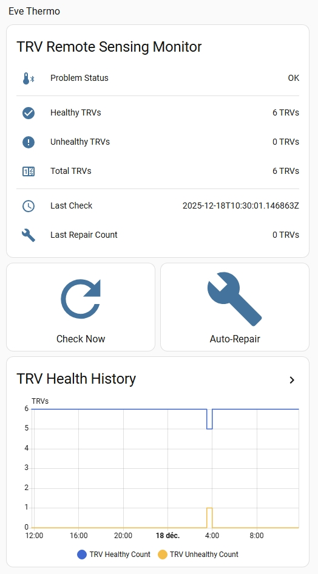
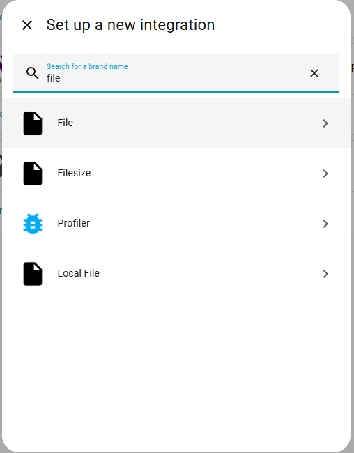
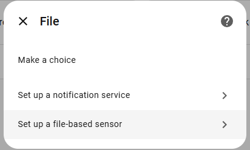
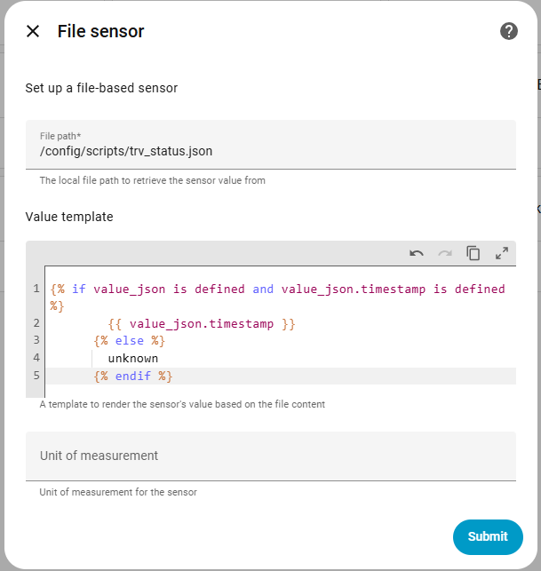
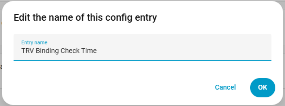
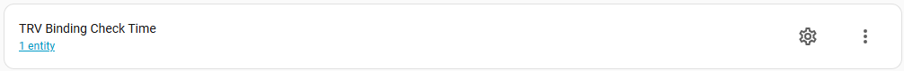
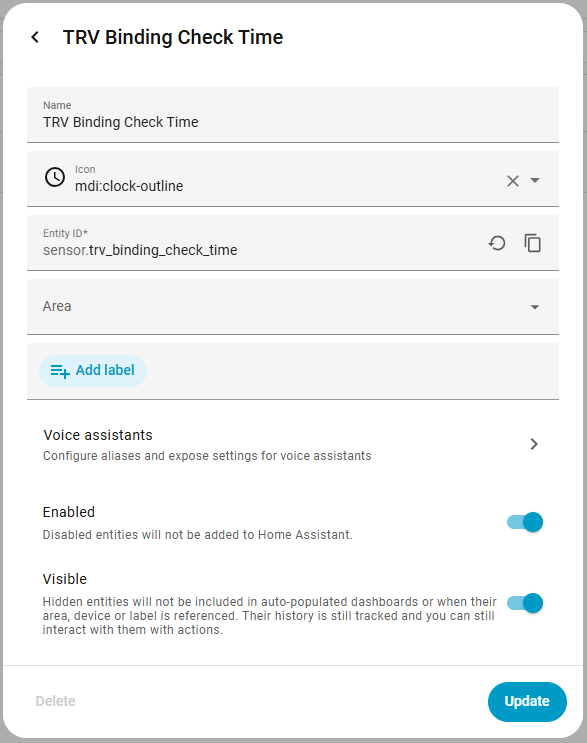
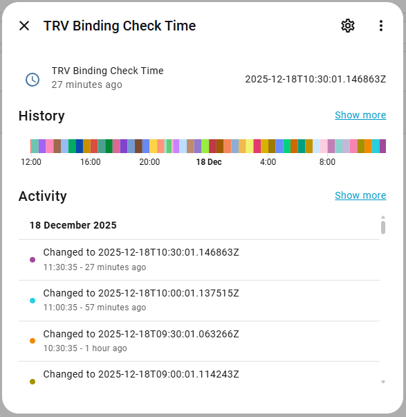

= Matter TRV Binding & Monitoring Scripts
:toc:
:toc-title: Table of Contents

ifdef::env-github[]
++++

<h3>ℹ️ Repository Notice</h3>

<strong>This is a mirror repository.</strong>

The primary repository is hosted on <strong><a href="https://git.araul.in/antoine/matter_trv_binding">GitLab</a></strong>.

<strong>Public contributions (Issues, Pull Requests) are managed on GitHub.</strong>

 
++++
endif::[]

ifdef::env-gitlab[]
++++

<h3>ℹ️ Contribution Notice</h3>

<strong>Public contributions (Issues, Pull Requests) are managed on GitHub.</strong>

Please visit the <strong><a href="https://github.com/antoineraulin/matter_trv_binding">GitHub Mirror</a></strong> to report issues or submit changes.

This GitLab repository is the canonical source for code, but external account creation is disabled.

 
++++
endif::[]

This repository contains Python scripts to enable and monitor **direct Matter bindings** between temperature sensors and Matter-enabled Thermostatic Radiator Valves (TRVs).

This allows TRVs to use an external temperature sensor (e.g., a Zigbee sensor exposed via Home Assistant Matter Hub or a native Matter sensor) instead of their internal sensor, providing much more accurate room temperature regulation.

NOTE: These scripts were developed for my personal needs. They are provided "as is" with no guarantee of support. I share them in the hope they are useful, but I will not necessarily fix bugs or support other hardware unless I have the time and need.

toc::[]

== Features

* **Direct Binding**: Links a temperature sensor to one or multiple TRVs.
* **Remote Sensing Activation**: configuring the TRV to use the external value.
* **Auto-Repair**: A monitoring script checks bindings periodically and re-applies them if the TRV reverts to internal sensing (a common issue when sensors are temporarily unavailable).
* **Home Assistant Integration**: Includes scripts and automations to monitor health and trigger repairs from Home Assistant.

== Hardware Compatibility

These scripts have been tested and verified with the following hardware (over a ~1 month period with 6 TRVs and 4 sensors):

* **TRVs**: Eve Thermo (various generations: native Matter and HomeKit-upgraded-to-Matter).
* **Sensors**: Zigbee thermometers exposed to Matter via the **Home Assistant Matter Hub** addons.

_It may work with other Matter thermostats, but this is not guaranteed._

== Dashboard

A comprehensive Home Assistant dashboard configuration is provided in `HA/dashboard/trv_binding.yaml`. It visualizes the health of your bindings and allows for manual interventions.

* **Status Indicators**: Instantly see if any TRV has lost its binding.
* **Controls**: Manually trigger a check or an auto-repair sequence.
* **History**: Track stability over time.

== Repository Structure

* `matter_trv_binding.py`: **Main Setup Script**. Used to establish bindings, create Access Control Lists (ACLs) on sensors, and enable remote sensing on TRVs. Use this for initial setup, adding new connections, or **cleaning up old ACLs**.
* `monitor_binding.py`: **Monitoring Script**. Designed to run on the Home Assistant host. It checks the status of bindings and can auto-repair them. It outputs a JSON status line for Home Assistant sensors.
* `HA/`: Contains Home Assistant configuration (automations, scripts, dashboards).

== Prerequisites

* **Home Assistant** with the **Matter Server** add-on installed and configured.
* Python 3 installed on the machine running the scripts (your local computer for the setup script, and the HA host for the monitor script).

== Installation & Usage

=== 1. Finding Device IDs

Before configuring the scripts, you need the **Node ID** and **Endpoint ID** for your devices.

* **TRV Node ID**:
  . Go to the Device page in Home Assistant.
  . Click on "Device Info" (or look at the URL/diagnostic data) to find the Matter Node ID.

* **Sensor Endpoint ID** (Crucial step):
  . Go to the Device page of the sensor (or the Hub device if using HA Matter Hub).
  . Download the **Matter Diagnostics** file (it's a JSON file).
  . Open the JSON and search for your sensor's name (e.g., `capteur_ht_bureau`).
  . You will find a key like `"361/57/5": "capteur_ht_bureau Temperature..."`.
  . The first number (e.g., `361`) is the **Endpoint ID**.

=== 2. Configuring and Running the Setup Script

. Open `matter_trv_binding.py`.
. Edit the `MATTER_URL` to point to your Home Assistant Matter Server (default is usually `ws://<HA_IP>:5580/ws`).
. Configure the `SENSOR_TRV_MAPPING` list with your device IDs.
+
[source,python]
----
SENSOR_TRV_MAPPING = [
    {
        "sensor_node": 9,           # Node ID of the sensor (or Hub)
        "sensor_endpoint": 361,     # Endpoint ID found in diagnostics
        "trv_nodes": [20, 6],       # List of TRV Node IDs to bind
        "description": "Office Sensor -> Office TRVs"
    }
]
----
. Run the script:

+
[source,bash]
----
python3 matter_trv_binding.py
----
This script will create the necessary ACLs on the sensor and write the binding configuration to the TRVs.

==== Cleaning Up Old ACLs
If you move a sensor or change your setup, you can use the script to remove old, unused ACLs to free up space on your devices.
. In `matter_trv_binding.py`, locate the `ENDPOINTS_TO_CLEANUP` configuration block.
. Add the Node ID and the *old* Endpoint IDs you want to remove.

[source,python]
----
ENDPOINTS_TO_CLEANUP = {
    9: [358],  # Remove ACLs for old endpoint 358 on node 9
}
----
. Run the script. It will automatically detect these endpoints and remove their ACL entries while preserving the active ones.

=== 3. Setting up Monitoring in Home Assistant

The `monitor_binding.py` script is intended to run periodically within Home Assistant.

==== Step 1: Place the Script
Copy `monitor_binding.py` to a `scripts` folder in your Home Assistant `/config` directory (e.g., `/config/scripts/monitor_binding.py`).

==== Step 2: Configure `allowlist_external_dir`
The monitoring script writes a JSON file that Home Assistant sensors read. You must allow access to this folder in `configuration.yaml` (see the repository's `configuration.yaml` for an example):
[source,yaml]
----
# Example configuration.yaml entry
homeassistant:
  allowlist_external_dirs:
    - /config/scripts
----

==== Step 3: Define `shell_command`
You also need to define the shell commands that will execute the python script. Add this to your `configuration.yaml`:
[source,yaml]
----
shell_command:
  # Check TRV status and write to file
  check_trv_bindings: "python3 /config/scripts/monitor_binding.py --output-file /config/scripts/trv_status.json --exit-code"

  # Check and auto-repair if needed
  repair_trv_bindings: "python3 /config/scripts/monitor_binding.py --output-file /config/scripts/trv_status.json --auto-repair"
----

==== Step 4: Configure File Sensors (Web UI)
File sensors must be set up via the Home Assistant UI. You will need to create a separate sensor for each metric you want to track.

**Generic Steps:**
. **Add File Integration**: Go to **Settings > Devices & Services > Integrations**, click **+ Add Integration**, and search for **File**.

. **Set up a File Sensor**: Choose the **File** option.
+

. **Configure**: Enter the file path and the specific value template (see table below).
* File path: `/config/scripts/trv_status.json`
+

. **Rename Config Entry**: Rename the integration entry (e.g., "TRV Healthy Count") to keep your configuration organized.
+

. **Rename Entity ID**: Click on the created entity, go to Settings, and rename the **Entity ID** to match the dashboard requirements.
+

**Required Sensors Table:**

Repeat the process above for each of the following metrics using the specified Value Template and Entity ID.

[cols="a,a,a"]
|===
|Metric |Value Template |Target Entity ID

|TRV Binding Check Time
|[source, jinja]
----

        {{ value_json.timestamp }}
      
        unknown
      
----
|`sensor.trv_binding_check_time`

|TRV Binding Status Raw
|[source, jinja]
----

        unhealthyhealthy
      
        unknown
      
----
|`sensor.trv_binding_status_raw`

|TRV Healthy Count
|[source, jinja]
----

        {{ value_json.healthy_trvs }}
      
        0
      
----
|`sensor.trv_healthy_count`

|TRV Repaired Count
|[source, jinja]
----

        {{ value_json.repaired_trvs }}
      
        0
      
----
|`sensor.trv_repaired_count`

|TRV Total Count
|[source, jinja]
----

        {{ value_json.total_trvs }}
      
        0
      
----
|`sensor.trv_total_count`

|TRV Unhealthy Count
|[source, jinja]
----

        {{ value_json.unhealthy_trvs }}
      
        0
      
----
|`sensor.trv_unhealthy_count`
|===

==== Step 5: Set up Automations
Import the automations from the `HA/` folder.
* The **Periodic Check** automation runs `monitor_binding.py` every 30 minutes.
* The script writes its output to a JSON file in the same directory.

== How It Works: Matter Binding & Remote Sensing

This project leverages standard Matter clusters to achieve direct device-to-device communication, even if the "direct" link is mediated by the Matter Fabric.

=== 1. The Binding Mechanism
The script creates a **Binding** on the TRV. In Matter, a binding is a persistent relationship that allows one node (the TRV) to send commands or requests to another (the Sensor).

* **Cluster**: `0x001E` (Binding Cluster)
* **Location**: The binding entry is written to the TRV's Binding Cluster (Endpoint 1). It targets the Sensor's Node ID and Endpoint ID, specifically for the Temperature Measurement Cluster (`0x0402`).
* **Code Reference**: See `matter_trv_binding.py`, where `client.send_command("write_attribute", ...)` writes to `1/30/0` (Endpoint 1 / Cluster 0x001E / Attribute 0 [BindingList]).

=== 2. Access Control Lists (ACLs)
For the TRV to read the temperature from the Sensor, it must have permission. Matter uses a decentralized ACL system.

* **Action**: The script writes a new ACL entry to the **Sensor**.
* **Permissions**: It grants the TRV (`subject`) the privilege to `VIEW` (`1`) the Sensor's data.
* **Authentication**: It uses `CASE` (`authMode: 2`), which is the standard certificate-based authentication for Matter.
* **Consolidation**: The script is smart enough to group TRVs. If multiple TRVs need to read the same sensor, they are added to the same ACL entry to save space (since devices often have a limit of 3-4 ACL entries per fabric).
* **Code Reference**: See the "Step 1: Rebuilding Sensor ACLs" section in the script.

=== 3. Remote Sensing Activation
Finally, the TRV must be told to *use* the external value instead of its internal thermistor.

* **Cluster**: `0x0201` (Thermostat Cluster)
* **Attribute**: `0x001A` (RemoteSensing)
* **Mechanism**: Setting **Bit 0** of this attribute to `1` enables remote temperature sensing. The TRV will then use the bound sensor's value for its control loop.
* **Code Reference**: See `matter_trv_binding.py`, where it reads `1/513/26` (Endpoint 1 / Cluster 0x201 / Attribute 0x1A), performs a bitwise OR with `1`, and writes it back.

== Credits

The logic of this project is largely based on the extraordinary work of link:https://github.com/judahrand[**Judah Rand**] and his gist `thermostat_binding.py` (link:https://gist.github.com/judahrand/cddefd4531fbebda1bf8eb1790398e3b[GitHub Gist]), as well as the official Matter documentation on binding mechanisms.

== AI Usage Disclaimer

I believe in transparency regarding the use of Artificial Intelligence.

* **Tools Used**:
** Local LLMs (specifically `devstral-2` and `ministral-3` from Mistral running on Ollama).
* **Scope**: AI was used for:
** Writing code comments and docstrings.
** Designing the CLI output (colors, formatting) to make it user-friendly.
** **Documentation**: This README was written with the assistance of `ministral-3` based on my French input, as English is not my primary language.
* **Human Contribution**: The core logic, error handling, algorithm, and Matter binding implementation were written and verified by a human.

== License

link:https://git.araul.in/antoine/matter_trv_binding[matter_trv_binding] © 2025 by link:https://git.araul.in/antoine[Antoine Raulin] is licensed under link:https://creativecommons.org/licenses/by-nc-sa/4.0/[CC BY-NC-SA 4.0] image:https://mirrors.creativecommons.org/presskit/icons/cc.svg[CC,16,16] image:https://mirrors.creativecommons.org/presskit/icons/by.svg[BY,16,16] image:https://mirrors.creativecommons.org/presskit/icons/nc.svg[NC,16,16] image:https://mirrors.creativecommons.org/presskit/icons/sa.svg[SA,16,16]